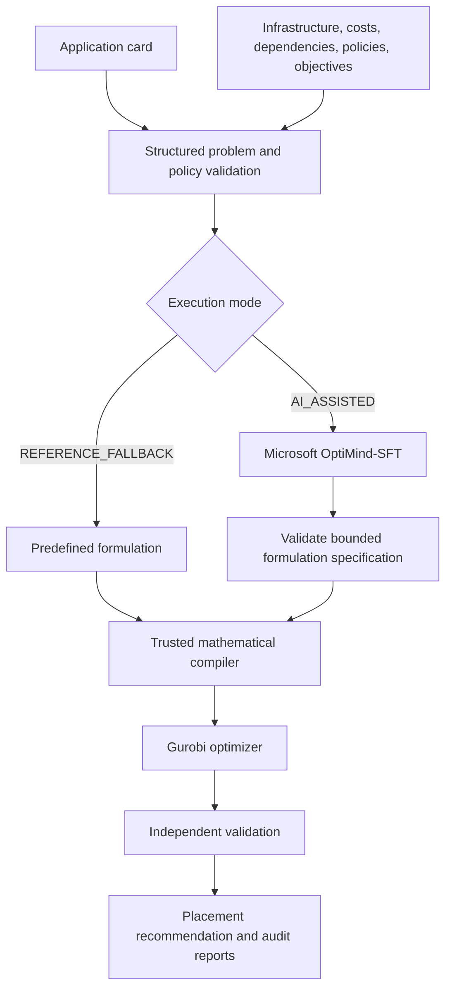

# Beyond LLMs and Machine Learning: AI-Assisted Decision Optimization

**Exploring a new approach to complex enterprise decision-making by combining AI, mathematical decision models, and optimization.**

Banks face complex technology decisions every day—from deciding where to host critical applications to balancing infrastructure costs, performance, regulatory requirements, and operational risks. Traditional approaches often rely on expert judgment, spreadsheets, and manual assessments. While Large Language Models (LLMs) can generate recommendations and Machine Learning (ML) can predict outcomes, a different challenge remains: How can organizations systematically identify the best possible decision while satisfying multiple business constraints?

This project explores AI-assisted decision optimization, an emerging approach that moves beyond generating answers or predicting outcomes to identifying mathematically optimized decisions. Using enterprise workload placement as a practical banking use case, it demonstrates how AI can assist in selecting a mathematical decision model, while an optimizer evaluates feasible alternatives to identify the best solution against defined business objectives and constraints. Although demonstrated through application hosting, this approach has broader potential across banking—including capital allocation, liquidity management, resource planning, risk management, and operational optimization—where decisions must balance competing priorities while respecting mandatory requirements.

## The business problem

Imagine a financial institution preparing to deploy a critical payments application. Its infrastructure spans AWS, Azure, and traditional data centers. The decision is not simply which cloud is cheapest. The bank must consider:

- **Cost:** What is the modeled total cost over three years?
- **Performance:** Can the application communicate quickly enough with existing shared services?
- **Policy:** Which providers and countries are permitted to host and process its data?
- **Capacity and services:** Are sufficient compute, memory and storage resources, and all required infrastructure services, available?
- **Resilience:** Can the selected location meet the application's recovery requirements?
- **Risk:** How does the placement affect concentration and potential failure impact?

Some requirements are mandatory; others are preferences to balance. The goal is to find the lowest-scoring **feasible** placement under the organization's configured priorities.

> **Why this project?** An LLM can suggest a hosting location, and machine learning can forecast future demand. But choosing the *best permitted* location across cost, performance, capacity, policy, and resilience requirements is a **decision optimization** problem. This project explores how a specialized AI model and an established mathematical solver can work together to address it.

This repository models **one new application at a time**, while using an existing portfolio of applications as fixed context. The example is synthetic: it is designed to illustrate an enterprise decision process, not to provide real banking advice or live cloud recommendations.

## How it works



Each component has a specific responsibility:

| Component | What it does |
|---|---|
| **OptiMind-SFT** | Selects a supported mathematical formulation specification. It **does not** choose the hosting site or invent unrestricted business constraints. |
| **Trusted Python compiler** | Builds the mathematical optimization model from the validated specification and original configuration. |
| **Gurobi** | Solves that model and reports whether an optimum has been proven. |
| **Independent validator** | Checks the selected placement against the modeled business, infrastructure, dependency, and recovery requirements. |
| **Explanation and audit reports** | Show what was selected, why it was selected, and which configured checks passed. |

**Mathematical optimality is relative to the supplied model and assumptions.** Passing modeled policy checks does not constitute external regulatory approval or production deployment certification.

## Verified experiment: `BANK-PAY-001`

The reviewed [execution evidence](examples/verified_ai_run/README.md), records that the application-driven pipeline was successfully run in **`AI_ASSISTED` mode with genuine Microsoft OptiMind-SFT inference**, followed by Gurobi optimization and independent validation. The run recorded `genuine_inference: true` and `fallback_used: false`.

The synthetic critical payments application includes **PROD, DEV, SIT, UAT, and dedicated local disaster recovery**. The existing shared identity service is a relevant application dependency.

### Recommended placement

| Environment | Recommended site |
|---|---|
| Production (PROD) | AWS Hong Kong (`AWS_HK`) |
| Development (DEV) | AWS Hong Kong (`AWS_HK`) |
| System integration testing (SIT) | AWS Hong Kong (`AWS_HK`) |
| User acceptance testing (UAT) | AWS Hong Kong (`AWS_HK`) |
| Dedicated local DR | AWS Hong Kong (`AWS_HK`) |

The DR model uses **independent local failure domains** at the selected site; it does **not** represent a geographically separate DR region.

### Verified results

| Measure | Recorded result |
|---|---|
| Mode | `AI_ASSISTED` |
| Model | `microsoft/OptiMind-SFT` |
| Pinned model revision | `817e06666a39155f9352d00354b3227d230da46d` |
| Genuine inference / fallback | `true` / `false` |
| AI-selected formulation | `DIRECT_ASSIGNMENT` |
| Objective encoding | `INLINE` |
| Mathematical model author | `TRUSTED_COMPILER` |
| Modeled 36-month TCO | **USD 102,240** |
| Modeled dependency latency | **5 ms** |
| Normalized objective score | **0.20** (lower is better) |
| Mathematical model | 21 variables; 111 linear constraints |
| Gurobi 13.0.2 result | `OPTIMAL`, 0.0 MIP gap |
| Independent validation | `DEPLOYABLE` (`valid: true`) |
| Recommendation | `RECOMMENDED` |
| Total recorded execution time | Approximately 86.4 seconds |

All costs and latencies are synthetic modeled values, not live prices or production measurements. The duration is one recorded pipeline attempt, not a cold-download benchmark. This documentation review did not rerun genuine inference.

### Why AWS Hong Kong?

The experiment balanced four weighted objectives: **36-month cost (35%)**, **dependency latency (25%)**, **infrastructure concentration (20%)**, and **modeled blast radius (20%)**. These weights are configurable business priorities, and lower normalized scores are better. Mandatory constraints cannot be traded away for a better score. The selected placement met those constraints and achieved the best weighted score.

Two complete placements were feasible in this scenario:

| Feasible placement | Modeled 36-month TCO | Modeled dependency latency | Objective score |
|---|---:|---:|---:|
| **AWS Hong Kong** for PROD, DEV, SIT, UAT and local DR | **$102,240** | **5 ms** | **0.20** |
| AWS Singapore for PROD and local DR; AWS Hong Kong for DEV, SIT and UAT | $111,744 | 25 ms | 0.60 |

The Singapore option improves concentration from 1.0 to 0.75, with blast radius unchanged at 1.0, but the Hong Kong option had lower modeled cost and latency, so it won under the specified weights. **This is a scenario-specific result, not a claim that AWS Hong Kong is universally the best location.**

The example application declares `data_country: SG`. This **selects a configured policy**; it does not automatically require Singapore-only hosting. In this synthetic scenario, the selected policy explicitly permits AWS hosting and processing in **Singapore or Hong Kong**. Real organizations must supply and independently review their own policy requirements.

### What was independently checked?

The generated audit reports record checks for site approval, configured residency/provider policy, required services, dependency latency, residual capacity, dedicated local DR, recovery objectives, and modeled materiality approval. The output's `DEPLOYABLE` status means **deployable under the configured model**, not independently approved for a real financial-services environment.

For an explanation of the checks, see [Regulatory audit documentation](docs/REGULATORY_AUDIT.md). The run generates three useful artifacts:

| Generated artifact | Contents |
|---|---|
| [recommendation.json](examples/verified_ai_run/recommendation.json) | Selected placement, cost and latency metrics, Gurobi result, AI provenance, and independent validation. |
| [placement_explanation.md](examples/verified_ai_run/placement_explanation.md) | Human-readable selection rationale, objective trade-offs, feasible alternatives, and constraint checks. |
| [constraint_audit.json](examples/verified_ai_run/constraint_audit.json) | Machine-readable checks with requirements, actual values, status, and evidence references. |

Each run writes these files in a unique `demo-<id>` directory under the chosen output directory; the notebook additionally groups runs under `launch-<id>`. Complete runs include input snapshots, a structured problem, provenance and a `COMPLETE.json` integrity manifest. Early input/preflight failures may occur before reports are created. The links above point to the retained public example, not temporary `results/` files.

## Two execution modes

| | `REFERENCE_FALLBACK` | `AI_ASSISTED` |
|---|---|---|
| Runs OptiMind-SFT inference? | **No** | **Yes** |
| Formulation selection | Predefined deterministic formulation | AI-selected bounded specification |
| Mathematical model | Trusted compiler | Trusted compiler |
| Placement optimization | Gurobi | Gurobi |
| Independent validation | Yes | Yes |
| GPU needed for OptiMind? | No | Yes, in the supported Colab workflow |
| Best use | Quick local tests, debugging, reproducible baseline | Genuine AI-assisted formulation experiment |

**`REFERENCE_FALLBACK` is a deliberately selected mode, not evidence of an AI failure.** Its legacy `fallback_used: true` flag also appears for explicit reference execution; `genuine_inference` is false. The AI-assisted workflow must not silently switch to reference mode if genuine inference fails. The locally checked reference pipeline also recommends AWS Hong Kong. The archived AI bundle includes an in-run bounded mathematical reference comparison, not a second archived Gurobi-only execution. Agreement demonstrates scenario consistency, not that AI outperformed the reference optimizer.

## Quick start: run without AI

### 1. Clone and install

```bash
git clone https://github.com/debabratapruseth/Optimind-Gurobi-Workload-Placement.git
cd Optimind-Gurobi-Workload-Placement
python -m venv .venv
source .venv/bin/activate
python -m pip install -r requirements.txt
```

Reference installation and tests have been checked on Python **3.14.5**; the recorded AI environment used Python **3.13.15**. These are verified environments, not a universal supported-version range. [requirements.txt](requirements.txt) pins PyYAML 6.0.3, Pydantic 2.12.3, gurobipy 13.0.2 and pytest 8.4.2.

You need an appropriate **Gurobi installation/license**. The recorded experiment used a size-limited Gurobi license; license suitability depends on the problem size and intended use. See the [licensing review](LICENSE_REVIEW_REQUIRED.md) before redistribution or commercial use.

### 2. Configure the application and infrastructure

| File | What to change |
|---|---|
| [config/application.yaml](config/application.yaml) | New application's environments, resource needs, criticality, dependencies, and recovery requirements |
| [config/infrastructure/sites.yaml](config/infrastructure/sites.yaml) | Candidate hosting locations and capabilities |
| [config/infrastructure/capacity.yaml](config/infrastructure/capacity.yaml) | Residual CPU, memory, storage, and GPU capacity |
| [config/infrastructure/costs.yaml](config/infrastructure/costs.yaml) | Modeled infrastructure and operating costs |
| [config/infrastructure/portfolio.yaml](config/infrastructure/portfolio.yaml) | Fixed existing applications and shared services |
| [config/policies/regulatory.yaml](config/policies/regulatory.yaml) | Allowed hosting/processing countries, providers, and approval requirements |
| [config/policies/dependencies.yaml](config/policies/dependencies.yaml) | Required connections and latency assumptions |
| [config/optimization/objectives.yaml](config/optimization/objectives.yaml) | Cost, latency, concentration, and failure-impact weights |
| [config/optimization/solver.yaml](config/optimization/solver.yaml) | Solver configuration |
| [config/scenario.yaml](config/scenario.yaml) | Top-level configuration wiring |
| [config/optimind.yaml](config/optimind.yaml) | OptiMind inference configuration for AI mode |

Keep exactly one new application card and match its ID in `scenario.yaml`. Existing portfolio applications remain fixed dependency/risk context; capacity inputs are residual after existing workloads, so do not subtract that usage again. Demand is per environment, with an additional DR reservation. See [input configuration](docs/INPUTS.md).

### 3. Run the reference optimizer

```bash
python -m src.pipeline \
  --config config/scenario.yaml \
  --mode REFERENCE_FALLBACK \
  --output results/reference
```

This runs Gurobi and independent validation **without** downloading or invoking OptiMind-SFT. The reference CLI requires neither a GPU nor a Hugging Face token. Inspect the generated run directory for `recommendation.json`, `placement_explanation.md`, and `constraint_audit.json`.

### 4. Run tests

```bash
python -m pytest -q -ra tests
```

## Run genuine OptiMind-SFT + Gurobi

Use the [Colab pipeline notebook](notebooks/run_pipeline.ipynb) and [AI runtime guide](docs/AI_RUNTIME.md). The recorded hardware was an NVIDIA A100-SXM4-80GB. Live GPU, RAM, disk, package, checkpoint and scenario checks must pass. The text-only stack pins Torch 2.13.0, Transformers 5.12.1 and Accelerate 1.15.0 in [inference requirements](requirements-inference-transformers.txt); torchvision must be absent. Provide `HF_TOKEN` through Colab Secrets with model access. Gurobi is still required.

1. Put the complete project, including tests/fixtures, in the configured Drive folder. Keep the saved repository notebook at `USE_AI=False`, `RUN_PIPELINE=False`, with outputs cleared before staging.
2. Run Step 1 to stage it. In the active notebook set `USE_AI=True`, `RUN_PIPELINE=False`, then run dependency setup and runtime verification. A Gurobi-only run first is optional.
3. Require the verification gate to pass. Set `RUN_PIPELINE=True` in the authorization cell and execute the launch cell once; it consumes the flag and prevents overlapping launches.
4. Inspect the new recommendation and reports. The notebook invokes `src.pipeline --mode AI_ASSISTED` with the configured scenario and runtime evidence, then synchronizes results to Drive.

The notebook's shared verification gate requires a Colab GPU runtime even when preparing reference mode; use the reference CLI above for CPU-only execution. Source/input changes require fresh verification. Reference success is not AI inference evidence.

A successful AI run must show `RECOMMENDED`, `source: OPTIMIND_SPEC_TRUSTED_MILP`, `genuine_inference: true`, `fallback_used: false`, solver `OPTIMAL` with proven optimality, and independent validation `DEPLOYABLE` with `valid: true`. Execution mode appears at `ai.mode` in `constraint_audit.json`; it is not a top-level field in `recommendation.json`.

## Repository guide

| Location | Purpose |
|---|---|
| [`config/`](config/) | Application, infrastructure, policy, and optimization inputs |
| [`src/`](src/) | Trusted compilation, solving, pipeline orchestration, and validation |
| [`notebooks/run_pipeline.ipynb`](notebooks/run_pipeline.ipynb) | Colab execution workflow for genuine AI inference |
| [`tests/`](tests/) | Automated checks and regression fixtures |
| [`docs/AI_RUNTIME.md`](docs/AI_RUNTIME.md) | AI environment and inference instructions |
| [`docs/REGULATORY_AUDIT.md`](docs/REGULATORY_AUDIT.md) | Modeled policy and residency interpretation |
| [`docs/ARCHITECTURE.md`](docs/ARCHITECTURE.md) | Detailed technical architecture |
| [`docs/VALIDATION.md`](docs/VALIDATION.md) | Testing and reproducibility |
| [`examples/verified_ai_run/`](examples/verified_ai_run/) | Reviewed public AI evidence subset |
| `results/` | Generated local runs; excluded from Git |


## Scope and limitations

- **Research proof-of-concept:** This is not a production banking placement system.
- **Synthetic inputs:** Application details, prices, network latency, capacity, recovery evidence, and policies are modeled assumptions, not live provider measurements or quotations.
- **Modeled compliance only:** Passing a configured regulatory check is not legal advice, regulatory approval, or an external compliance certification.
- **Bounded infrastructure:** Exactly ten candidate sites, common per-environment demand, and bounded formulation/equivalence checks; no live infrastructure discovery or automated deployment.
- **Single new application:** The documented workflow optimizes one new application against a fixed existing portfolio; it does not claim production-scale joint portfolio optimization.
- **Local DR:** The example uses independent local failure domains, not geographically separate disaster recovery.
- **Bounded AI role:** OptiMind chooses from supported formulation options. It does not author unrestricted equations, infer missing enterprise policies, or directly select a site.
- **Solver guarantee:** `OPTIMAL` establishes optimality for the mathematical model provided, not universal superiority across unmodeled conditions.
- **Licensing and security:** Review model, Gurobi, dependency, and evidence-distribution terms before public or commercial use. Do not publish private runtime files or credentials.

## License and research status

The existing [MIT license](LICENSE) covers this repository as stated in that file; model weights, model-output redistribution rights, Gurobi and dependencies have independent terms. The selected source and synthetic example were reviewed for this research release; commercial-use eligibility and a comprehensive production security audit are not certified. No model weights, credentials, local machine paths or license files are included in the public example.
